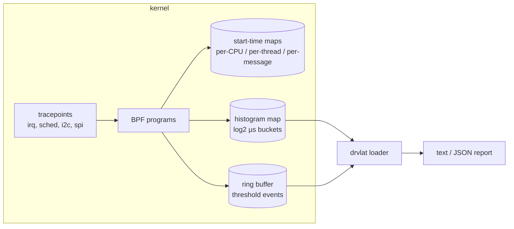

# drvlat

**Driver latency histograms for embedded Linux, built with eBPF.**

`drvlat` answers the questions that come up during board bring-up and real-time tuning: *how long do my interrupt handlers run, how long does a threaded IRQ wait before it gets the CPU, and how long does each I2C or SPI transfer really take?* It reports log2 histograms in microseconds per IRQ line, softirq vector, IRQ thread, I2C device and SPI chip select, and can log every sample that crosses a latency threshold.

It uses **stable kernel tracepoints only, no kprobes**, so it works on production images built without `CONFIG_KPROBES`. It is built on **libbpf CO-RE**, so one binary runs across kernel versions.

## What it measures

| Mode | Measures | Tracepoints | Key |
| --- | --- | --- | --- |
| `hardirq` | Hard IRQ handler run time | `irq_handler_entry` / `irq_handler_exit` | IRQ number + name |
| `softirq` | Softirq handler run time | `softirq_entry` / `softirq_exit` | vector (TIMER, NET_RX, BLOCK…) |
| `irqthread` | Threaded IRQ wake-up → on-CPU latency | `sched_wakeup` / `sched_switch` | `irq/NN-name` thread |
| `i2c` | Transfer time, first message → result | `i2c_read` / `i2c_write` / `i2c_result` | adapter + 7-bit address |
| `spi` | Message time, start → done | `spi_message_start` / `spi_message_done` | bus + chip select |

GPIO interrupts are covered by `hardirq` and `irqthread`: filter with `-n gpio` or the name of your driver.

## Example

Softirq BLOCK handler run time on an x86 VM under disk load:

```
$ sudo ./build/drvlat -m softirq -n BLOCK -d 3

== softirq handler run time ==

  BLOCK   count 80   avg 12.5 us   max 56.5 us
                   usecs : count    |distribution                            |
           2 -> 3        : 12       |**************                          |
           4 -> 7        : 10       |***********                             |
           8 -> 15       : 34       |****************************************|
          16 -> 31       : 23       |***************************             |
          32 -> 63       : 1        |*                                       |
```

Catch outliers as they happen with a threshold:

```
$ sudo ./build/drvlat -m softirq -t 60
SLOW softirq   TIMER                    cpu0         94.1 us
```

More captured output is in [`docs/`](docs/).

## Usage

```
drvlat [-m MODES] [-i SEC] [-d SEC] [-t US] [-n STR] [-c] [--json]

  -m, --modes LIST     hardirq,softirq,irqthread,i2c,spi,all
                       (default: hardirq,irqthread,i2c,spi)
  -i, --interval SEC   print every SEC seconds (default: once at exit)
  -d, --duration SEC   stop after SEC seconds
  -t, --threshold US   also print every sample >= US microseconds
  -n, --name STR       only rows whose name contains STR
  -c, --cumulative     keep histograms across intervals
  -j, --json           JSON Lines output, one object per report or event
```

Typical bring-up checks:

```bash
sudo drvlat -m i2c -i 5                 # is the sensor bus slow or just one device?
sudo drvlat -m hardirq,irqthread -n gpio -t 200   # GPIO IRQ worst cases on PREEMPT_RT
sudo drvlat -m spi -d 30 --json > spi.json        # log for a CI or soak test
```

## Build

Requirements: clang ≥ 11, bpftool, libbpf ≥ 1.0, libelf, zlib, and a kernel with `CONFIG_DEBUG_INFO_BTF=y`.

```bash
# Debian / Ubuntu / Raspberry Pi OS
sudo apt install clang libbpf-dev libelf-dev zlib1g-dev bpftool   # or linux-tools-$(uname -r)
make
sudo ./build/drvlat
```

`make` generates `build/vmlinux.h` from the running kernel's BTF. To build on a host for a different board, copy the target's `/sys/kernel/btf/vmlinux` and run `make VMLINUX_BTF=path/to/vmlinux CC=aarch64-linux-gnu-gcc` with a cross libbpf.

Modes whose tracepoints are missing (no I2C or SPI subsystem, for example) are skipped with a note instead of failing.

## How it works



- Hard IRQ handlers run with interrupts disabled, so a **per-CPU** slot holds the start time with no locking.
- I2C transfers are synchronous and keyed by **thread id**; SPI messages can complete asynchronously and are keyed by the **message pointer**.
- I2C and SPI event layouts are declared locally with `preserve_access_index`. libbpf matches them against the target kernel's BTF at load time, so the tool builds even on a host kernel without those subsystems.
- Histograms are aggregated in the kernel; user space only reads the map at each interval, keeping overhead low on small CPUs.

## Test status

| Mode | Status |
| --- | --- |
| `hardirq`, `softirq` | Built and run on x86-64 Linux 6.18 (VM) |
| `irqthread` | Built and loaded; the VM has no threaded IRQs to report |
| `i2c`, `spi` | Built; these tracepoints were absent on the test kernel, so not yet run |
| Raspberry Pi 3 (arm64) | Next: run all modes against real I2C and SPI sensors |

## Roadmap

- Raspberry Pi 3 results with I2C and SPI sensors
- SMBus tracepoints for adapters with native SMBus support
- Yocto recipe for a `meta-drvlat` layer
- Optional per-CPU breakdown for hard IRQs

## License

BSD-2-Clause. The BPF program is also available under GPL-2.0-only, as the kernel requires for GPL-only BPF helpers. See [LICENSE](LICENSE). Author: Manish Soni.
